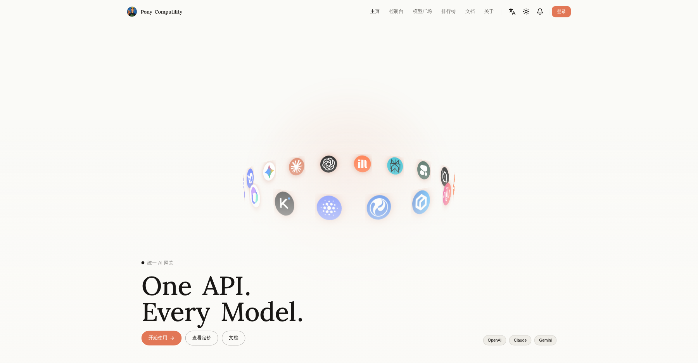
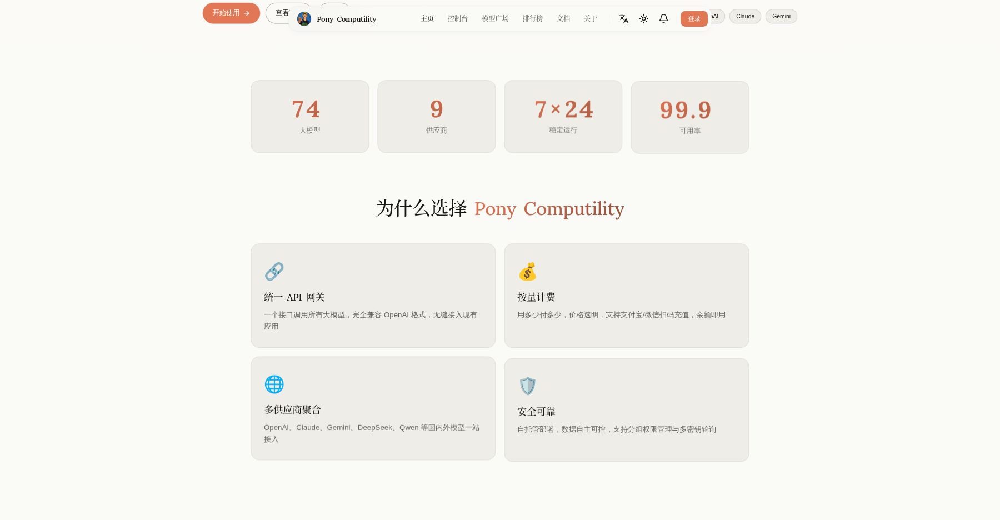
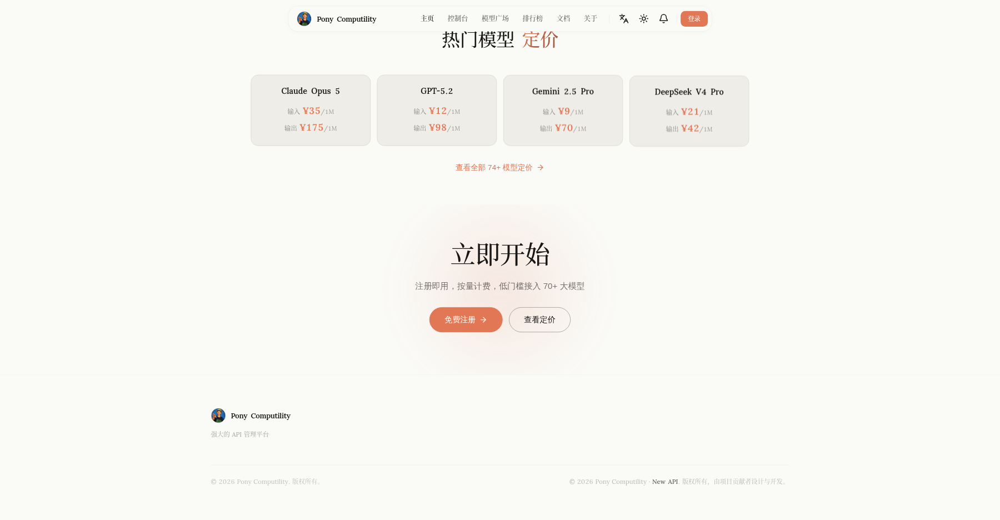
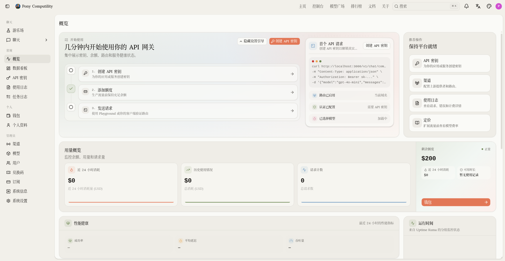
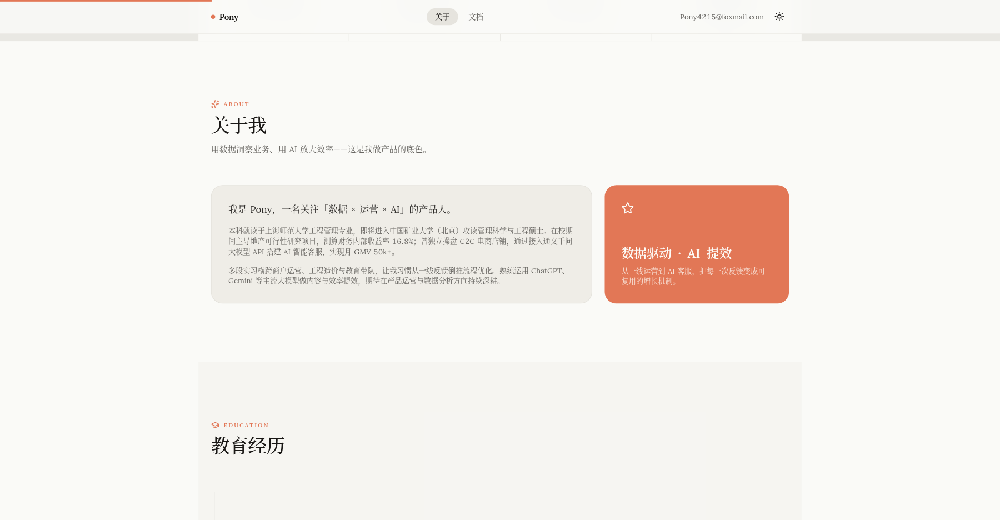

# Pony Computility

Pony Computility 是一个 AI API 网关演示项目，将多个模型提供商接入统一接口，并提供 API 密钥、用量统计、模型定价和管理控制台等页面。首页以围绕圆环旋转的大模型标识为视觉焦点，搭配简洁的暖色界面；登录后可进入控制台查看配置引导和用量概览。

本项目基于 **New API** 开源代码进行部署与定制，并保留 **QuantumNous** 署名。上游项目：[QuantumNous/new-api](https://github.com/QuantumNous/new-api)。

## 网页实测截图

以下截图来自浏览器实际运行页面，展示首页、模型价格、登录后控制台和关于页面。模型数量、价格、余额及运行指标会随站点配置变化，截图只反映测试时页面显示的内容。



| 首页功能介绍 | 热门模型与定价 |
| --- | --- |
|  |  |

| 登录后控制台 | 关于页面 |
| --- | --- |
|  |  |

## 功能亮点

- **统一 API 接入**：通过兼容 OpenAI 的接口访问已配置的上游模型，也支持 Claude、Gemini 等提供商协议。
- **模型渠道管理**：集中配置上游凭据、模型映射、分组、优先级和负载调度。
- **密钥与权限管理**：为用户创建独立 API 密钥，并控制可用模型和分组。
- **用量与费用统计**：查看请求日志、额度消耗、模型用量和渠道状态。
- **管理后台**：完成用户、渠道、定价、系统选项和运行状态的管理。
- **简洁首页**：Pony 品牌、模型环绕动画、柔和留白和清晰的注册、定价入口；界面默认采用 Anthropic 风格主题。
- **多语言与多数据库**：前端提供多语言界面；后端支持 SQLite、MySQL 和 PostgreSQL。

## 目录结构

```text
.
├── common/             # 通用工具、缓存、配置和数据库支持
├── controller/         # HTTP 控制器
├── dto/                 # 请求与响应类型
├── middleware/          # 认证、限流、日志等中间件
├── model/               # 数据模型和数据库访问
├── relay/               # API 中转与各上游提供商适配器
├── router/              # API、后台和网页路由
├── service/             # 业务逻辑
├── setting/             # 系统、模型和运行设置
├── docs/                # API、安装和功能文档
├── web/                 # React 前端源码与静态资源
├── electron/            # 可选的桌面托盘客户端
├── Dockerfile           # 前后端容器构建
├── docker-compose.yml   # 本地/单机部署配置
├── .env.example         # 环境变量示例
└── README.md
```

## 运行方式

### Docker Compose

需要 Docker Compose。先创建本地环境文件，并替换数据库和 Redis 的示例密码：

```bash
cp .env.example .env
```

编辑 `.env`，为 `POSTGRES_PASSWORD` 和 `REDIS_PASSWORD` 设置强随机值（建议使用 URL 安全字符），然后构建并启动：

```bash
docker compose up -d --build
docker compose logs -f new-api
```

启动后访问 <http://localhost:3000>，按初始化页面创建管理员，然后配置上游渠道、模型和用户 API 密钥。容器数据保存在 `./data` 和 Docker 命名卷中。

停止服务：

```bash
docker compose down
```

`docker compose down -v` 会删除数据库命名卷及其数据，请仅在确定要重置实例时使用。

### 本地开发

需要 Go、Bun 和 Node.js。前端构建产物由 Go 服务嵌入，因此首次启动后端前先构建前端：

```bash
cd web
bun install --frozen-lockfile
bun run build
cd ..
go run .
```

默认服务地址为 <http://localhost:3000>。单独开发前端时，在 `web/` 运行 `bun run dev`，并在另一个终端启动后端。

## 配置说明

复制 `.env.example` 为 `.env` 后按需调整。Docker Compose 会从 `.env` 读取变量；敏感值应保存在本地环境文件或部署平台的密钥管理中，不要提交真实 `.env`。

| 变量 | 用途 |
| --- | --- |
| `POSTGRES_PASSWORD` | Compose PostgreSQL 密码，启动前必须设置 |
| `REDIS_PASSWORD` | Compose Redis 密码，启动前必须设置 |
| `PORT` | 服务监听端口，默认 `3000` |
| `SQL_DSN` | 主数据库连接串；未设置时应用使用默认 SQLite 配置 |
| `REDIS_CONN_STRING` | Redis 连接串；未设置时可使用内存缓存 |
| `SESSION_SECRET` | 多实例部署时用于会话签名的随机密钥 |
| `SESSION_COOKIE_SECURE` | HTTPS 部署时启用安全 Cookie 与来源校验 |
| `SESSION_COOKIE_TRUSTED_URL` | 安全 Cookie 模式下允许的 HTTPS 来源列表 |
| `TRUSTED_PROXIES` | 反向代理地址或 CIDR 列表 |

Compose 示例用于单机部署。公开部署前请设置强密码、配置 HTTPS 和可信代理，并根据实际情况限制数据库、Redis 的网络访问。SQLite、MySQL 和 PostgreSQL 的连接配置示例见 `.env.example`。

## 使用示例

在后台添加可用渠道和模型、创建 API 密钥后，将 `your-model-id` 替换为该密钥允许访问的模型：

```bash
curl http://localhost:3000/v1/chat/completions \
  -H "Authorization: Bearer $PONY_API_KEY" \
  -H "Content-Type: application/json" \
  -d '{
    "model": "your-model-id",
    "messages": [{"role": "user", "content": "你好，介绍一下你自己。"}]
  }'
```

兼容 OpenAI 的客户端可将 `base_url` 设为 `http://localhost:3000/v1`，并使用后台生成的 API 密钥。

## 文档与许可

- 网站内置的用户版 API 接入教程保存在 [`web/public/pony-computility-api-tutorial.html`](./web/public/pony-computility-api-tutorial.html)，启动后访问 `/docs` 查看；如果该静态教程无法加载，页面会回退到管理后台配置的文档内容。
- [上游项目说明（简体中文）](./README.zh_CN.md)
- [上游项目说明（English）](./README.en.md)
- [安装文档](./docs/installation/BT.md)
- [API 文档](./docs/openapi/api.json)
- [许可证](./LICENSE)：GNU Affero General Public License v3 或更高版本

上游项目名称 **New API**、组织署名 **QuantumNous**、许可证及第三方版权声明均按原项目要求保留。本仓库没有包含部署实例数据库、运行日志或真实 API 凭据。
